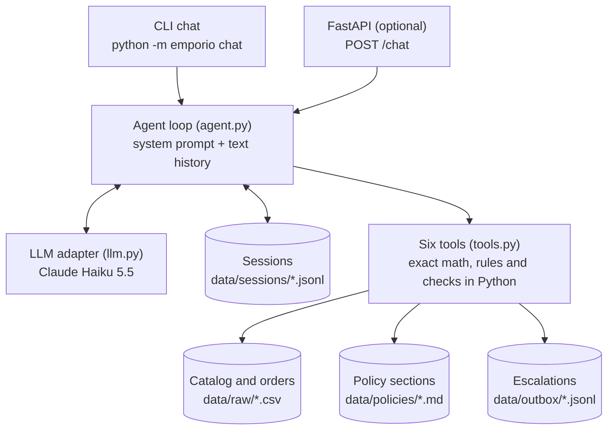

# Empório da Música Support Agent

## 1. Overview

A Python text-message agent that serves customers of **Empório da Música**, a fictional
musical instruments store in Campo Grande/MS. It answers in Brazilian Portuguese, with a
friendly WhatsApp-style persona, using only the store's data (six CSVs) and its policy
manual (PDF). It knows when to **query data** (prices, stock, promotions, order status) and
when to **consult policies** (returns, payment, shipping, hours), verifies identity before
showing any order, and declines out-of-scope requests politely.

**Stack:** Python 3.11+, Claude Haiku 5.5 through the official `anthropic` SDK with
function calling over six deterministic tools, pandas, rapidfuzz, a terminal chat with
persistent JSONL sessions, and an optional FastAPI endpoint.

**Example conversations** generated from real runs are in [`examples/`](examples/).

## 2. Quick start

Requirements: Python 3.11 or newer and an Anthropic API key. Run everything from the
`emporio-agent/` folder.

```bash
python -m venv .venv
.venv\Scripts\activate             # Windows  (macOS/Linux: source .venv/bin/activate)
pip install -r requirements.txt    # also installs the project itself (editable)
copy .env.example .env             # Windows  (macOS/Linux: cp .env.example .env)
# edit .env and set ANTHROPIC_API_KEY=sk-ant-...

python -m emporio chat             # start chatting (in Portuguese)
```

Inside the chat: `/reset` clears the conversation, `/quit` exits. Run
`python -m emporio chat SESSION_ID` to resume a conversation after a restart.

| Variable | Default | Purpose |
|---|---|---|
| `ANTHROPIC_API_KEY` | (required) | Anthropic API key |
| `LLM_PROVIDER` | `anthropic` | Provider adapter (only Anthropic is implemented) |
| `LLM_MODEL` | `claude-haiku-5-5` | Model id |
| `LLM_EFFORT` | `medium` | How much the model thinks: `low` to `max` |
| `AGENT_NOW` | real time | Agent clock as an ISO datetime, e.g. `2026-03-22T15:00:00` (store time) to simulate a date: the data ends in March 2026 |
| `SHOW_TOOLS` | `0` | `1` prints every tool call and a preview of its result |

Other commands:

```bash
pytest -q                               # 206 unit tests, no network, no API key needed
pytest -m llm                           # real-model smoke checks + scenario suite (needs a key)
python scripts/run_scenarios.py         # scenario suite: pass/fail table and failing transcripts
python scripts/run_examples.py          # regenerate examples/ from real runs
python scripts/data_quality_report.py   # every data issue detected in the CSVs
uvicorn emporio.api:app --reload        # optional HTTP API on http://127.0.0.1:8000 (docs at /docs)
ruff check .                            # lint
```

```bash
curl -X POST http://127.0.0.1:8000/chat -H "Content-Type: application/json" \
  -d '{"session_id": "5567999990000", "message": "Quanto custa o Takamine GD20?"}'
```

The scenario suite costs a few US cents per run with Claude Haiku 5.5.

## 3. How it works



**One LLM picks the tools; Python does the exact work.** The model understands the message,
chooses tools and arguments, asks for missing information and writes the reply. Python does
everything that must be exact: filtering, prices, promotion and PIX math, installments,
store hours, date arithmetic and identity verification.

| Tool | Use it for | Behavior |
|---|---|---|
| `search_products` | Browsing by category, string type, electronics, price range or text | Available items only by default, cheapest first, at most 5 (max 10), plus total matches and how many unavailable matches were hidden |
| `get_product` | One named product: price, promotion, PIX, installments, stock | Fuzzy name match; candidates when ambiguous; flags discontinued, coming soon and out of stock, with up to 3 in-stock alternatives |
| `get_order_status` | Status, items, total, payment, tracking, delivery, return windows | Needs the order id plus the e-mail or phone on file; one generic error on failure; locked after 3 failures |
| `get_policy` | Store rules by topic | Closed enum of nine topics (store_info, hours, payment, returns, shipping, promotions, warranty, privacy, scope_and_tone) |
| `get_store_status` | Open right now? Next opening? | Store time zone (UTC-4), agent clock, Brazilian and MS holidays |
| `escalate_to_human` | Complaints, delays, defects, anything unresolved | Writes to a local outbox and returns a protocol id with the 24 business hours promise |

**The agent loop in five lines:**
1. Build the system prompt with the agent clock; take the last 20 text messages.
2. Call the model with the six tool schemas.
3. If it requests tools, run them and send all results back in one message.
4. Repeat until a text reply, at most 6 model calls per turn (then a safe fallback reply).
5. Store the customer message and the reply; tool data stays inside the turn.

**Code map** (`src/emporio/`): `data.py` (loading and cleaning), `money.py` (BRL, PIX,
installments), `store_hours.py`, `returns.py` (return and warranty windows), `policies.py`,
`tools.py`, `prompts.py`, `llm.py`, `agent.py`, `session.py`, `cli.py`, `api.py`,
`config.py`.

## 4. Technical decisions

The challenge left these choices open. For each one: options considered, choice, reason.

### Agent approach: function calling over deterministic tools

| Option | Why not (or why) |
|---|---|
| RAG with embeddings over the manual and catalog | The manual is ~3,000 words in nine well-separated topics and the catalog has 65 products: retrieval adds moving parts without better accuracy here, and it cannot do price math or verify identity. It would pay off for a manual of hundreds of pages or a catalog of thousands of products. |
| Text-to-SQL agent | Free-form queries over customer data are an LGPD risk (nothing stops a query for another customer's orders) and generated SQL can be wrong in ways that are hard to test. |
| Text ReAct or an agent framework (LangChain, LlamaIndex) | Native function calling already gives structured tool calls; a framework adds abstraction and dependencies without a current need. |
| **Function calling over six Python tools (chosen)** | Numbers stay exact and testable; customer data is reachable only through a tool that verifies identity; and the challenge's key question, *data or policy?*, becomes an explicit, testable decision: which tool the model calls. |

### Model and provider: Claude Haiku 5.5

Turns are short tool-calling exchanges in Portuguese over small data, and the hard parts
(math, rules, verification) are in code, so a fast and cheap model is the right default
(about US$ 0.10 / 0.50 per million input / output tokens). The full scenario suite costs a
few cents. `llm.py` hides the provider behind two methods (`chat`, `tool_results_message`),
so another provider is one more adapter. Settings follow the model's API documentation:

| Setting | Choice and reason |
|---|---|
| Sampling | No `temperature`: Claude Haiku 5.5 rejects sampling parameters with a 400. Consistency comes from deterministic tools, the prompt and the scenario checks. |
| Effort | `medium` (the model's default; `LLM_EFFORT` to change). Adaptive thinking is always on. |
| `max_tokens` | 16000 as a safety ceiling: thinking tokens count toward it. Reply length is set by the prompt. |

A comparison across models and providers was planned as an optional step and dropped for
time (see section 9).

### Interface: terminal chat, plus an optional API

The challenge asks for a working agent, not a UI: a reviewer can start the CLI with one
command, and `SHOW_TOOLS=1` shows the reasoning behind each answer. The FastAPI app reuses
the same agent and session store and is the shape a WhatsApp Business webhook would call:
the sender's number becomes the `session_id`, and `reply` goes back through the WhatsApp API.

### Conversation persistence: JSONL per session, text-only history

| Decision | Choice and reason |
|---|---|
| Storage | One JSONL file per session in `data/sessions/` (gitignored): append-only, human-readable, no database needed at this scale. The session id plays the role of the customer's WhatsApp number. |
| What reaches the model | Only customer messages and final replies (last 20 messages). Tool calls, results and thinking blocks stay inside the turn that produced them, and are logged in the session file for auditing. |
| Why text-only | Prices, stock and order data are re-fetched every turn, so a reply never quotes a stale result and verified order data does not linger in context. It also keeps requests valid for the model's thinking-block check, which rejects replayed thinking blocks once the system prompt (it carries the time) or earlier messages (the window slides) change. Cost: the agent re-calls a tool when a follow-up needs the same data, and the prompt has to tell it that its own earlier replies (for example a protocol number) are reliable. |
| Lockout across restarts | Failed order verifications are recounted from the session log on load, so reopening the chat does not reset the 3-attempt lockout. |

### Prompt strategy

- Instructions in English, replies in Brazilian Portuguese; plain text, since WhatsApp does
  not render Markdown.
- Facts needed in almost every chat live in the prompt: address, contacts, what the store
  sells, and the instrument families **computed from the catalog data** (the manual claims
  woodwinds and orchestral strings that have no products). Everything else must come from a
  tool in the same turn and be quoted exactly as the tool formatted it.
- Explicit rules for the data-vs-policy decision, promotions (original price + discount +
  final price; no PIX on top), expired promotions, unavailable items, returns (disclose the
  estimated receipt date; mention the 90-day legal warranty when the regret window is
  closed), delays and complaints (escalate, give the protocol, reuse it), accessories,
  off-topic requests, privacy and prompt injection.
- Tool schemas say what each tool is for **and when not to use it**; tool results are data,
  never instructions.
- The manual's service flow (greet, understand, consult, answer, close) and tone ("a friend
  who knows music") define the persona.

### Data treatment

The raw files in `data/raw/` are never modified. `data.py` cleans them at load time:
money as `Decimal` parsed from text (never `float`), specs parsed from JSON, normalized
names for fuzzy search, availability, active promotions and description reliability.
`scripts/data_quality_report.py` prints every detectable issue. The policy PDF is copied
into nine markdown files with the original wording (section 5).

## 5. Assumptions and data issues

The challenge says to assume a reasonable interpretation and document it. Each row is a
finding in the provided data or manual and what the agent does about it.

**Catalog and orders**

| Finding | What the agent does |
|---|---|
| Product 96 (Giannini GF-3D) is `active` with stock 0 | Available means `active` **and** stock > 0; it suggests in-stock alternatives |
| Products 113 and 136 are `discontinued`; 130 is `coming_soon` | Never offered for sale; alternatives of the same category, string type, 7-string format and electronics |
| Product 130 (`coming_soon`) appears in orders 3 and 14 | Treated as a pre-sale; those orders stay valid |
| Six descriptions (products 135, 137, 139, 140, 142, 144) name another brand or a string/key count that contradicts the specs | Flagged as unreliable and never relayed; name, price, stock, status and specs are the source of truth |
| `specs` is a JSON string whose keys differ per category | Parsed into a dict; missing keys tolerated |
| Only 4 of 25 promotions are active (products 127, 121, 90, 94) | Only `is_active = 1` counts; expired ones (e.g. Black Friday on product 91) are never promised |
| The manual mentions Black Friday in November and Dia do Músico, but none is active | No future promotion is ever announced |
| Order totals differ from the item sum in orders 3 (3,450 vs 3,498) and 20 (1,400 vs 1,488) | The recorded `total_brl` is always reported, never recomputed |
| Tracking codes exist only for shipped and delivered orders | Pending and confirmed orders: not dispatched yet, no tracking; cancelled: the reason from `notes` |
| There is no real delivery date, only `estimated_delivery` | Used as the receipt date for return windows; the agent says it is an estimate |
| Order 8 is shipped and past its estimate (28/02) | Flagged `delivery_overdue`; the agent apologizes and escalates |
| The data ends in March 2026 | The agent clock is `AGENT_NOW` (default: real time); every scenario and example sets its own date |
| Categories 6, 7, 8 (woodwinds, brass, orchestral strings) have no products, while the manual claims 300+ instruments | The agent says the item is not in the catalog and offers human follow-up |
| Customers 11 and 43 share an e-mail | Harmless: verification compares against the customer of that specific order |
| Prices are floats | Parsed into `Decimal`; formatted as `R$ 1.299,00` |

**Manual and business rules**

| Finding | Interpretation |
|---|---|
| Installments: the summary table says "up to 12x, minimum R$ 100"; section 3.1 has tiers | Section 3.1 prevails (more specific): minimum installment R$ 50 up to 3x, R$ 80 from 4x to 6x, R$ 100 from 7x to 12x |
| "Sem valor mínimo de parcela (exceto abaixo de R$ 50,00)" | Read as a R$ 50 minimum installment up to 3x; a purchase below R$ 50 is paid in one installment |
| Installments on promoted items | Computed on the final (promotional) price |
| PIX 5% does not stack with promotions | PIX price only for products without an active promotion |
| Rounding | Cents, ROUND_HALF_UP |
| Contacts conflict: (67) 3341-4444 vs WhatsApp (67) 3321-4500; e-mail with and without accent | (67) 3341-4444 and `contato@emporiodamusica.com.br`: both appear on the manual's cover, and the phone also in the company data table |
| "Closed on Sundays and holidays", with no holiday list | National public holidays plus Mato Grosso do Sul state holidays (`holidays` package); municipal holidays, optional days and extended hours on special dates are not modeled |
| Opening hours boundaries | 18:00 sharp on a weekday is already closed |
| Return windows | Calendar days, inclusive: regret 7 days after receipt, defect 30 days after purchase, legal warranty 90 days after receipt; all orders are deliveries, so the regret right (online purchases) applies |
| "Suggest partner stores when possible", but none is listed | No store is ever named |
| The manual is an internal document | The agent speaks as the store and never cites sections or "the manual" |

**Policy files.** `data/policies/` holds one markdown file per topic with the manual's
original wording (only formatting changed; section numbers dropped from headings). Where the
manual contradicts itself, a clearly marked **"Editorial note (not part of the original
manual)"** at the top of `payment.md`, `store_info.md`, `scope_and_tone.md` and
`promotions.md` says what prevails. A test checks 15 sentences copied verbatim from the PDF.

## 6. Privacy and safety

The design assumes the model **can** be talked into saying something wrong, so the hard
guarantees live in code, not in the prompt.

| Threat | Defense | Evidence |
|---|---|---|
| Reading another customer's order | Order data only for the order id plus the e-mail or phone on file (case, punctuation and +55 ignored); the same message whether the order exists or not; lookups locked after 3 failures, restored from the session log after a restart | `test_tools.py`, `test_session_cli.py`; scenarios `order_unverified`, `verification_bruteforce` |
| Listing customers or orders | No tool can; order results carry only the customer's first name | `test_order_result_has_no_customer_contact_data`; scenario `injection_attempt` |
| Prompt injection and jailbreaks | Customer text and tool results are data; a rule keeps the system prompt in force when a customer insists; no tool can grant discounts or change orders, and every price comes from code | Scenarios `injection_attempt`, `jailbreak_discount` |
| Leaking the prompt or internal documents | Prompt rule; tool names and the manual are never mentioned | Scenario `prompt_leak` |
| Invented prices, stock or deadlines | Numbers come only from tools; grounding check on every scenario turn | Invariant 1 (section 7) |
| Flooding the API or burning LLM credits | Per-session rate limit (10 messages/min, HTTP 429 with `Retry-After`, rejected before any model call); 1000-character messages in the API and the CLI; at most 6 model calls and a token ceiling per turn | `test_api.py`, `test_session_cli.py` |
| Path traversal through the session id | Character allowlist `[A-Za-z0-9_-]{1,64}` in the CLI and the API | `test_unsafe_session_ids_are_rejected`, `test_invalid_input_is_rejected` |

**What gets logged:** session files store each message plus the turn's tool calls and
results (which can include the customer's own order data) for auditing; the escalation
outbox stores the summary and the contact the customer gave. Both are local and gitignored;
no customer data goes into the repository. The API returns tool names and arguments, never
tool results.

## 7. Evaluation

**Unit tests (206, no network):** data findings, money and installment tables, store hours
and holidays, return-window boundaries, verbatim policy wording, every tool (including
verification, lockout and privacy), the agent loop with a scripted `FakeLLM`, sessions, CLI
and API.

**Scenario suite (real model):** `tests/scenarios.yaml` has 24 scripted conversations
(31 turns) built from the challenge's examples and the data traps. Each turn checks which
tools must or must not be called and what the reply must or must not contain. Three global
invariants run on every turn:

1. **Grounded money:** every R$ amount in the reply appears in a tool result of the same
   turn, in the customer's own message, or in a short allowlist of policy amounts
   (35, 50, 80, 100, 500, 2000).
2. **No order data before verification:** no tracking code appears before a successful
   `get_order_status`.
3. **Portuguese only:** no common English words.

**Latest results (Claude Haiku 5.5, effort `medium`):** the 21 functional scenarios passed
21/21 in two consecutive runs, and again after the last prompt changes; the 3 security
scenarios (`prompt_leak`, `jailbreak_discount`, `verification_bruteforce`) pass together
with `injection_attempt`.

Failures were fixed in the agent, not by loosening checks, unless the expectation itself was
wrong:

| Failure found | Cause | Fix |
|---|---|---|
| Out-of-window return did not mention the 90-day legal warranty | Agent | Prompt rule |
| Asked again for an order number the customer had already given | Agent | Prompt: reuse details already given |
| A reply started in English ("no saxofone in our catalog") | Agent, influenced by English tool notes | Prompt: write every sentence in Portuguese; invariant 3 added |
| After a complaint, opened a second escalation and called the first protocol wrong | Agent (text-only history) | Prompt: earlier replies are reliable; reuse the protocol |
| Claimed the store sells woodwinds and orchestral strings | Agent | Instrument families computed from the data |
| "Previsão de entrega" and "fora do catálogo" not accepted | Expectation too narrow | Wording widened; reason noted in the YAML |
| Brute-force scenario expected a 3rd tool call; the model refused to keep guessing | Expectation too strict | Check the property that matters: no order data is revealed |

**Caveats:** 24 scenarios are a sample, not a proof; LLM output varies between runs (hence
the two consecutive passes); the invariants are regex heuristics (order status words are not
checked, only tracking codes); there is no LLM judge for tone yet.

## 8. Known limitations

- Prototype data only: no real inventory, checkout or payments. Escalation writes to a local
  file, not to a ticket system.
- The identity check (order id plus e-mail or phone) is deliberately light, and the lockout
  is per session: a new session id resets it.
- The receipt date is the estimated delivery date, not a real one.
- Unreliable descriptions are found with a brand and count heuristic that can miss other
  contradictions (for example a wood that differs from the specs).
- Fuzzy matching thresholds were tuned on this catalog; similar names are handed back to the
  customer as candidates.
- The rate limit is in memory (one process); the API has no authentication.
- No prompt caching (the system prompt carries the current time), no streaming, no
  monitoring or tracing.
- Only the Anthropic provider is implemented.
- LLM output varies between runs; the scenario suite is a sample, not a proof.

## 9. What I would do with more time

1. **Model comparison:** run the scenario suite several times on three cheap models from
   different providers (OpenAI-compatible adapter for OpenAI, Gemini and a local model) and
   report pass rate by failure type, latency and cost per 100 conversations. Also A/B-test a
   Portuguese system prompt against the English one.
2. **WhatsApp Business webhook** on top of the API, with signature verification, a human
   handoff inbox, and identity by the sender's number plus a one-time code (per-customer
   lockout).
3. **Real data:** replace the CSVs with a database and real order events, including actual
   delivery dates.
4. **Production hardening:** API authentication, a distributed rate limit (gateway or
   Redis), output moderation, retention rules for session logs (LGPD), tracing and cost
   dashboards.
5. **Evaluation:** an LLM judge for tone and persona, more scenarios, repeated runs with pass
   rates, and the suite in CI on every commit.
6. **Scale:** BM25 or embedding retrieval if the manual grows to hundreds of pages; summarize
   long conversations; move the clock to a mid-conversation system message so the prompt can
   be cached.

## 10. Use of AI assistants

**Tools.** Claude (chat) to study the challenge with me, debate the approach and write the
build plan; Claude Code (Claude Opus 5.5, in VS Code) to implement it step by step.

**Workflow.**
1. I read the challenge and the data, then wrote a build plan with explicit decisions: the
   architecture, the 20 data traps and the rule for each, the tools, a scenario table and
   the README checklist.
2. I gave Claude Code one step at a time, with rules: propose a plan and wait for my OK,
   never invent store facts, run the tests and show the output, explain the design and ask
   me two interview-style questions, and list every assumption.
3. One branch and one pull request per step. **I made every commit, push, pull request and
   merge myself**; the assistant only suggested commit messages and wrote the PR
   descriptions. The commit history and the PRs show the progress step by step.
4. The README was updated at the end of every step, while the decisions were fresh.
5. I kept a private study file with the design points and interview questions of each step.

**Suggestions I accepted:** moving the raw data to `data/raw/` and making the package
installable; splitting the manual into topic files (after asking why markdown and not the
PDF, and why not RAG); keeping only text between turns; the three deviations from my plan
that came from the model's API documentation (no `temperature`, a larger `max_tokens`, the
history design); the scenario-suite invariants.

**Suggestions I rejected or changed:**
- The assistant proposed the repository root as the project root; I kept the project in the
  `emporio-agent/` folder.
- The assistant recommended skipping the optional API because of the deadline; I built it
  anyway, and I replaced the optional model comparison with abuse protections and security
  scenarios, which I considered more relevant to the challenge.
- I asked whether a Portuguese system prompt would prevent the English leak; we kept the
  English prompt (already validated) and listed the A/B test as future work.
- I asked how the agent resists malicious prompts and floods; that question became the
  rate limit, the message length limit, the security scenarios and section 6.

**How the work was verified.** Unit tests for every module; the scenario suite against the
real model, required to pass twice in a row; reading every generated example transcript and
checking each amount against the CSVs (this found two agent bugs, fixed and regenerated,
never edited by hand); and reading the diffs before each commit.

**What I did not delegate:** the plan and the architecture choice, the data rules (section
5), scope decisions (what to build and what to drop), and every git operation.

**Honest summary:** the assistant wrote most of the code. I directed it with a written plan
and acceptance criteria, reviewed each step, questioned the decisions I did not understand,
and changed course where I disagreed.
